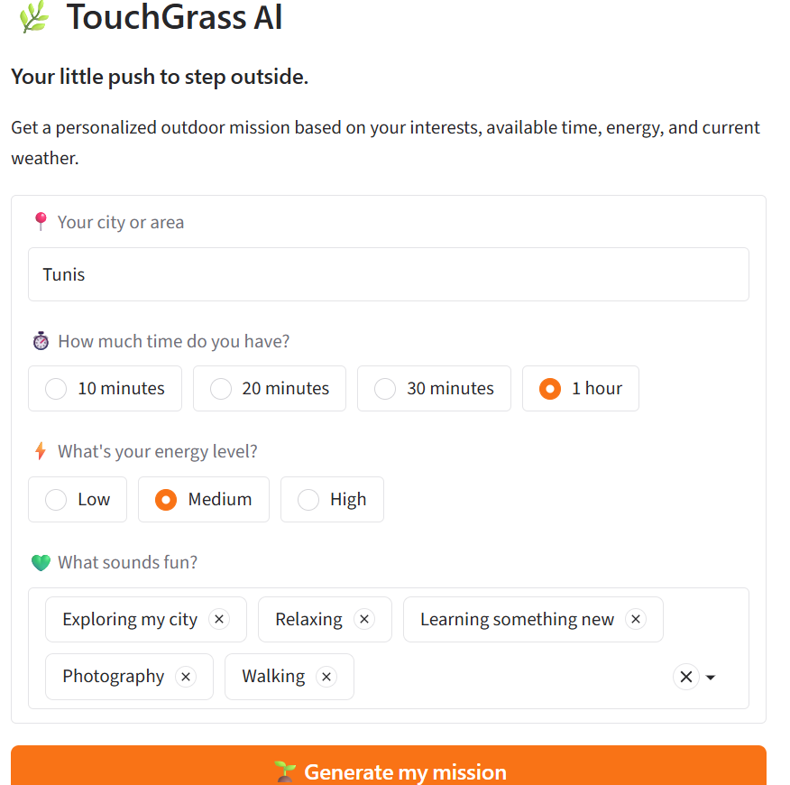
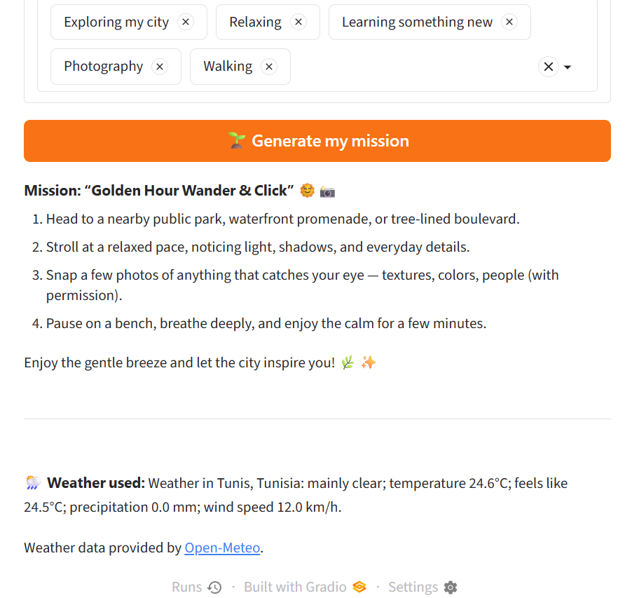

 <div align="center">

# 🌿 TouchGrass AI

### Less scrolling. More exploring. ☀️

**Your AI-powered nudge to step outside, touch grass, and make the most of your day.**

🌱 Get outside · 🌤️ Check the weather · 🗺️ Discover your next little adventure

<br>

<a href="https://github.com/mounab3/touchgrass-ai">
  
</a>
<a href="#-how-it-works">
  
</a>

<br>


</div>

---

<div align="center">

> 🍃 **A little fresh air can change your whole day.**
>
> What if AI didn't just keep us on our screens, but helped us step away from them?

</div>

## 🌼 What is TouchGrass AI?

TouchGrass AI is a small AI-powered project with one simple mission: **help people spend less time scrolling and more time experiencing the real world.**

Tell it your city, how much time you have, your energy level, and what you enjoy. It checks the current weather and uses AI to suggest a personalized outdoor mission that fits your day🌳

## 🌱 How it works

<div align="center">

| 🍀 You tell  | 🌤️ It checks | 🌻 You get |
|:---:|:---:|:---:|
| Your city, time, energy & interests | Current weather conditions | A personalized outdoor mission |

</div>

### ✨ Features

- 🌍 **Your location:** Enter your city to get weather information for your area.
- 🌦️ **Live weather:** Fetch current weather data using the Open-Meteo API.
- 🧠 **AI-generated missions:** Receive creative activity ideas tailored to your preferences.
- ⏳ **Time-friendly suggestions:** Find something to do even when you only have a few minutes.
- 🔋 **Energy-aware ideas:** Get suggestions that suit how energetic or relaxed you feel.
- 🎨 **Simple, interactive interface:** Enter your preferences and discover your next mission.
- 🌧️ **Weather-conscious suggestions:** Unfavorable conditions can prompt safer alternatives.

## 🍃 A little preview

<div align="center">

<!-- Add your screenshots to the screenshots/ folder using these filenames. -->



*Choose your city, available time, energy level, and interests.*

<br><br>



*Get your personalized mission and take the first step outside!*

</div>


## 🌳 The technology

<div align="center">

| Technology | What it does |
|:---|:---|
| 🐍 **Python** | Application logic and data processing |
| 🎨 **Gradio** | Interactive web interface |
| 🌤️ **Open-Meteo API** | Current weather information |
| 🤖 **OpenRouter API** | Connects the app to the selected AI model |
| 🌿 **NVIDIA Nemotron 3 Ultra** | Generates personalized outdoor activity suggestions |
| 🔐 **python-dotenv** | Loads configuration and API keys from environment variables |

</div>

### 💚 Why open-weight AI?

TouchGrass AI explores how open-weight models can be used to create practical applications that encourage healthier relationships with technology.

Instead of building another tool designed to keep people scrolling, this project uses AI to help turn a few preferences into a reason to go outside.

**The goal is simple: use technology as a bridge to the real world, not a replacement for it.**


## 🚀 Get started

Want to grow your own copy of TouchGrass AI? Follow these steps.

### 1. 🌱 Clone the repository

```bash
git clone https://github.com/mounab3/touchgrass-ai.git
cd touchgrass-ai
```

### 2. 🪴 Create a virtual environment

```bash
python -m venv .venv
```

Activate it on Windows PowerShell:

```powershell
.\.venv\Scripts\Activate.ps1
```

### 3. 🌿 Install the dependencies

```bash
pip install -r requirements.txt
```

### 4. 🔑 Configure your API key

Create a file named `.env` in the project folder:

```env
OPENROUTER_API_KEY=your_api_key_here
```

Replace `your_api_key_here` with your own OpenRouter API key.


### 5. ☀️ Start your adventure

```bash
python app.py
```

Open the local URL shown in your terminal, usually:

`http://127.0.0.1:7860`

That's it! You're ready to generate your first outdoor mission. 🌻

## 🗺️ Project structure

```text
touchgrass-ai/
│
├── app.py              # Main application
├── requirements.txt    # Python dependencies
├── .env                # Private API key (not committed)
├── .gitignore          # Files Git should ignore
├── README.md           # You are here! 🌿
│
└── screenshots/        # App screenshots
    ├── touchgrass-home.png
    └── touchgrass-mission.png
```

## 🌻 What's next?

TouchGrass AI is a learning project, and there is plenty of room to grow!

- [ ] 🌿 Improve activity suggestions and personalization.
- [ ] 🗺️ Explore more reliable local recommendations.
- [ ] 📱 Make the interface even friendlier on mobile.
- [ ] 🌞 Test the app with more users and different weather conditions.
- [ ] 🌳 Add more ways to encourage small, screen-free adventures.

## 🤝 Contributing

Have an idea that could help people spend more time outside?

You're welcome to explore the code, suggest improvements, or open an issue. Small contributions can grow into something meaningful. 🌱

1. Fork the repository.
2. Create a branch for your changes.
3. Make your improvements.
4. Submit a pull request.

## 💌 

I built TouchGrass AI as part of my journey exploring open-source AI and practical software development.

I wanted to experiment with a different use of AI.
🌿

---

<div align="center">

### 🌞 Made with curiosity, code, and a little love for the outdoors.

**TouchGrass AI · Less scrolling. More exploring.** 🍃

</div>